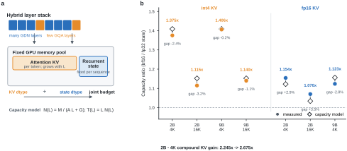

# Precision Accounting for Hybrid LLM Serving

Research artifact for **Precision Accounting for KV and Recurrent-State
Caches in Hybrid LLM Serving**, accepted at **DLS 2026**, the 2nd Workshop
on Data Security and LLM Safety in Smart Systems, co-located with IEEE
MASS 2026. The camera-ready manuscript and its supporting evidence are
available in this repository.

**Research question:** When attention KV caches and fixed-size recurrent
state share one memory pool, how do their precision choices affect the
capacity of a hybrid LLM serving stack?

| | Project at a glance |
|---|---|
| Models and engine | Qwen3.5-2B/9B with a pinned vLLM build |
| Experimental hardware | One NVIDIA RTX 5090, 32 GB |
| Main contribution | Byte-exact joint cache accounting and reconstruction of discrete block/page allocation |
| Evidence | A 112-cell allocator matrix, quality reanalysis, offline selector traces, and temporal serving audits |
| Release | `dls2026-camera-ready`, September 27, 2026 |

[Read the camera-ready paper](paper/dls2026/main.pdf) ·
[Verify the artifact](docs/artifact.md) ·
[Browse canonical results](results/README.md) ·
[Environment](docs/environment.md)



## Method and findings

Attention KV storage grows with context length; recurrent state is fixed
per sequence. The continuous accounting model is

$$
C(L) = \frac{L M}{A L + G},
$$

where $A$ is attention-KV bytes per token, $G$ is recurrent-state bytes per
sequence, $M$ is the cache budget, and $L$ is context length. The study
connects this model to vLLM's discrete block and page allocation, then
checks quality, serving stability, and an offline precision selector that
rejects configurations when required evidence is missing or a constraint
fails.

| Evidence | Supported result | Source of record |
|---|---|---|
| Allocator capacity | bf16 recurrent state increases token capacity in all 52 paired fp32/bf16 comparisons; median gain **15.44%** | [Corrected capacity analysis](results/verified/2026-08-14/capacity-phase-formal-corrected.analysis.json) |
| Accounting accuracy | Median absolute residual **2.38%**; signed residuals range from −5.16% to +13.21% | [Corrected capacity matrix](results/verified/2026-08-14/capacity-2x2-analysis-corrected.json) |
| GSM8K quality | State-only change: −1.00 percentage point, 95% CI [−2.04, +0.04]. int4-KV change: −2.72 points, [−5.28, −0.17] | [Item-and-seed clustered analysis](results/quality/gsm8k-state9seed-v2-dependence-aware-20260814.json) |
| Offline selection | The strict request selects full precision; medium, high, and negative-control requests have no feasible candidate | [Selector audit](results/verified/2026-08-14/controller-decisions/selector-audit.json) |
| Temporal serving stability | The primary stability gate fails: **183/720** continuous-goodput comparisons exceed the 10% tolerance | [Temporal reproduction gate](results/reproduction/2026-08-13/m4-four-config/gate4-r3/m4_gate4_validation.json) |

Capacity means **allocator token capacity**, not demonstrated concurrent
requests or a general throughput improvement. Conclusions are limited to
the measured models, engine build, hardware, and workloads. The study
characterizes existing precision controls; it does not introduce a new
quantizer, cache allocator, or online scheduler. The continuous model's
residuals also mean that it is neither a lower nor an upper capacity bound.

## Quick verification

Use **Linux or WSL2 with Python 3.10–3.12**. No GPU, model weights, or
dataset downloads are required for this verification tier.

```bash
git clone https://github.com/TanC8186/hybrid-cache-precision.git
cd hybrid-cache-precision
python3.12 -m venv .venv
source .venv/bin/activate
python -m pip install --upgrade pip
python -m pip install -e ".[analysis,dev]"
./reproduce.sh verify
```

This runs the unit tests and the manuscript evidence verifier. The latter
checks **16 source hashes and eight vector-figure pairs**, including the
corrected capacity source, two-way clustered GSM8K inference, and the
crossover and state-share values in Section III of the paper. Passing an
integrity check preserves the reported failed-gate results.

To regenerate the committed figures from frozen aggregate evidence:

```bash
./reproduce.sh figures
```

Full GPU re-execution requires the 32 GB RTX 5090 environment, external
model weights and datasets, and the pinned vLLM patch stack. Follow the
[artifact guide](docs/artifact.md) and its per-study launchers. The unified
`make sweep`, `bench`, `eval`, and `analyze` targets are unimplemented and
exit with pointers to those launchers. Native Windows vLLM execution is
outside the supported environment.

## Repository guide

| Path | Purpose |
|---|---|
| [`docs/artifact.md`](docs/artifact.md) | Verification, output regeneration, and GPU reproduction instructions |
| [`src/kvcache/`](src/kvcache/) | Quantization, cache, calibration, and selector research code |
| [`configs/`](configs/) | Frozen model, dataset, precision, benchmark, and experiment contracts |
| [`scripts/`](scripts/) | Per-study launchers, analyzers, selector tools, and figure builders |
| [`tests/`](tests/) | Unit and contract tests |
| [`results/quality/`](results/quality/) | Aggregated quality analyses |
| [`results/verified/`](results/verified/) | Frozen contracts, hashes, and validation evidence |
| [`results/reproduction/`](results/reproduction/) | Temporal reruns and audit reports |
| [`paper/dls2026/`](paper/dls2026/) | DLS camera-ready manuscript and editable figure sources |
| [`paper/mlsys2026/`](paper/mlsys2026/) | Earlier, longer-format manuscript of the same study |
| [`vendor/vllm-patches/`](vendor/vllm-patches/) | Reconstructable two-commit vLLM patch stack |
| [`data/MANIFEST.yaml`](data/MANIFEST.yaml) | Dataset provenance, licenses, revisions, and checksums |

The two manuscript directories use the same evidence; they are not
independent replications. Raw model weights, datasets, virtual environments,
downloaded vLLM sources, and large server archives are excluded. Frozen
contracts preserve original server paths as provenance; copy and adapt
them for a new machine instead of changing archived contracts.

## Citation and license

Junxi Tan, Yinhao Xiao, and Wencheng Yang. **Precision Accounting for KV
and Recurrent-State Caches in Hybrid LLM Serving.** DLS 2026, co-located
with IEEE MASS 2026. Accepted; camera-ready artifact released September
27, 2026.

Machine-readable metadata is in [`CITATION.cff`](CITATION.cff). The
camera-ready references the `dls2026-camera-ready` tag. A persistent
archival DOI is planned and has not been assigned in this repository.

The repository's own code and documentation use the [MIT license](LICENSE).
Vendored code and external datasets retain their original terms; see
[`vendor/README.md`](vendor/README.md) and
[`data/MANIFEST.yaml`](data/MANIFEST.yaml).
